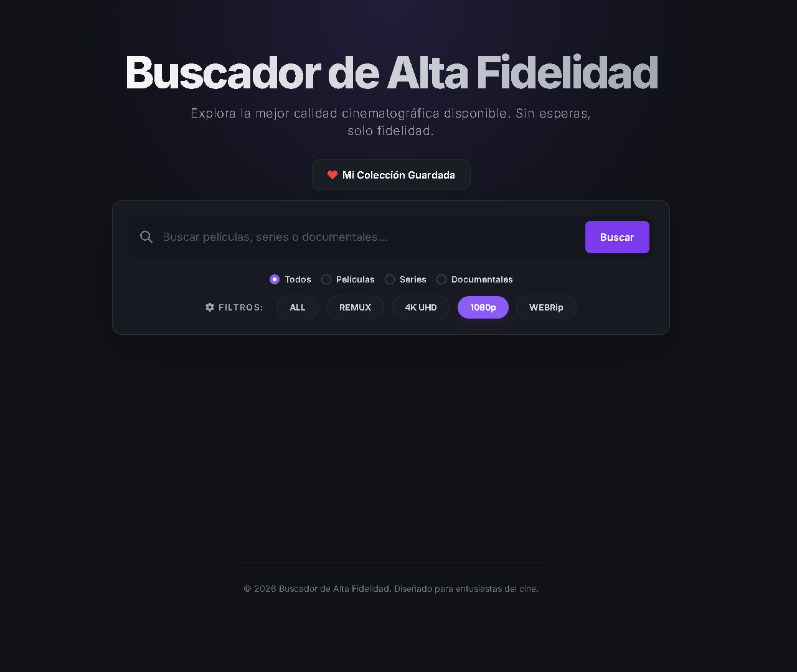

# Media Tracker - Buscador de Alta Fidelidad

Una aplicación web ultrarrápida y estéticamente premium diseñada para entusiastas del cine y las series. Funciona como un metabuscador que se conecta a tu instancia local de [Prowlarr](https://github.com/Prowlarr/Prowlarr) para rastrear y filtrar enlaces Torrent (Películas, Series y Documentales) ofreciendo los resultados de manera unificada, inteligente y visualmente atractiva con integración a TMDB.

## ✨ Características Principales

- **Filtros Avanzados**: Búsqueda exclusiva por categorías (Películas, Series, Documentales o Todos) y filtro visual rápido por calidad gráfica (1080p, 4K UHD, REMUX, WEBRip).
- **Agrupación Inteligente**: En lugar de mostrar cientos de torrents desordenados, la aplicación (gracias a `parse-torrent-title`) agrupa todas las variantes de una misma obra bajo una única tarjeta expandible.
- **Integración con TMDB**: Automáticamente obtiene el póster oficial, año de lanzamiento y sinopsis en español de la base de datos de TMDB para presentar las obras.
- **Temporadas Completas Destacadas**: Detección automática de "Pack de Series" o temporandas enteras (`is_full_season`). Estos resultados se fijan a la parte superior de cada grupo con una insignia dorada.
- **Copiar Magnet con un Clic**: Interfaz sin fricciones. Un solo botón para abrir el Torrent o un botón dedicado para copiar el Magnet al portapapeles y pasarlo por WhatsApp/Telegram.
- **Soporte FlareSolverr Multiplicado**: Totalmente compatible con indexadores pesados (como 1337x) que requieren bypass de Cloudflare (los timeouts de conexión están ajustados tolerar las demoras sin problemas).
- **Indicadores de Idioma**: Detección inteligente si el archivo contiene audio "Latino", "Castellano" o "Subtitulado".
- **Estimación Técnica por Release**: A partir del nombre del torrent y de la duración real de TMDB se estiman fuente (REMUX/BluRay/WEB-DL), códec, bits de color, HDR, formato de audio, bitrate y **bits por píxel (bpp)**, con un veredicto de calidad (Excelente / Muy buena / Correcta / Floja). Permite filtrar por calidad mínima, excluir HDR y ordenar por mejor calidad sin descargar nada.

## 🚀 Requisitos

Necesitarás tener instalado y corriendo en tu equipo local:

- Python 3.10 o superior.
- [Prowlarr](https://github.com/Prowlarr/Prowlarr) (Corriendo por defecto en el puerto `9696`).
- _(Opcional pero Recomendado)_ [FlareSolverr](https://github.com/FlareSolverr/FlareSolverr) para acceder a indexadores protegidos por Cloudflare como 1337x.

## 🛠 Instalación y Uso

1. **Clonar este repositorio:**

   ```bash
   git clone https://github.com/tu-usuario/rastreador-de-torrents.git
   cd rastreador-de-torrents
   ```

2. **Crear y activar un entorno virtual (opcional pero recomendado):**

   ```bash
   python -m venv venv
   # En Windows:
   venv\Scripts\activate
   ```

3. **Instalar dependencias:**

   ```bash
   pip install -r requirements.txt
   ```

4. **Configurar Variables de Entorno:**
   Renombra el archivo `.env.example` a `.env` (si existe, o simplemente crea `.env`) en la carpeta raíz, e ingresa tus credenciales:

   ```env
   # URL de Prowlarr. Cambiar solo si no corre en local.
   PROWLARR_URL=http://localhost:9696

   # Tu llave de API de Prowlarr (Puedes verla en la web de Prowlarr en Settings > General).
   PROWLARR_API_KEY=tu_api_key_de_prowlarr

   # Límite de resultados a solicitar a Prowlarr por búsqueda (default: 500)
   PROWLARR_SEARCH_LIMIT=500

   # [Opcional] API Key de The Movie Database para obtener Posteres. Obtener en: https://www.themoviedb.org/settings/api
   TMDB_API_KEY=tu_api_key_de_tmdb_aca

   # [Opcional] OpenSubtitles v3 API para descarga de subtítulos
   OPENSUBTITLES_API_KEY=tu_api_key_opensubtitles
   OPENSUBTITLES_USER=tu_usuario
   OPENSUBTITLES_PASSWORD=tu_password

   # [Opcional] Cliente Deluge Web UI para envío directo de magnets
   DELUGE_URL=http://localhost:8112
   DELUGE_PASSWORD=deluge

   # [Opcional] Redis para caché y rate-limiting persistentes.
   # Si se deja vacío o Redis no responde, se usa almacenamiento en memoria.
   REDIS_URL=
   ```

5. **Ajustes Adicionales de Prowlarr (Recomendado):**
   - Asegúrate de asignar FlareSolverr como proxy en Prowlarr desde _Settings > Indexers_, en caso de indexadores caidos o bloqueados por CF.

6. **Ejecutar el Servidor Web:**

   ```bash
   python app.py
   ```

7. **A disfrutar:** ¡Abre tu navegador web y visita [http://localhost:5000](http://localhost:5000)!

## 🐳 Despliegue con Docker (opcional)

El proyecto incluye un `Dockerfile` y un `docker-compose.yml` listos para producción. El compose levanta la app con **Waitress multi-hilo** y un **Redis** para caché y rate-limiting persistentes.

```bash
# 1. Crear el .env con tus claves (Prowlarr, TMDB, etc.)
cp .env.example .env

# 2. Levantar app + Redis
docker compose up -d --build
```

La aplicación quedará disponible en [http://localhost:5000](http://localhost:5000). Redis almacena el estado de caché y de los límites de peticiones, por lo que sobrevive a reinicios y funciona correctamente con múltiples hilos.

## 🖥️ Ejecutable para Windows (PyInstaller)

El proyecto puede empaquetarse como un único `app.exe` que incluye `templates`, `static` y `assets`.

```bash
pip install pyinstaller
python -m PyInstaller app.spec --noconfirm
```

El ejecutable se genera en `dist/app.exe`.

> **Importante:** el `.exe` lee las claves del archivo `.env` ubicado en el **directorio de trabajo** desde donde se ejecuta. Si lo lanzás desde `dist/`, colocá ahí tu `.env` (por ejemplo `dist/.env`).

### Inicio con un solo clic (Windows)

Hacé doble clic en `iniciar-media-tracker.bat`, en la raíz del proyecto. La estructura esperada es:

```text
Media-Tracker/
├── dist/app.exe
├── flaresolverr/flaresolverr.exe
└── iniciar-media-tracker.bat
```

El lanzador usa rutas relativas, inicia FlareSolverr en una ventana propia con `LANG=en-US` y `LOG_LEVEL=info` (dejá esa ventana abierta para consultar los registros), espera a que `http://127.0.0.1:8191/` responda `FlareSolverr is ready!`, y recién después arranca `dist\app.exe`. Cuando `http://127.0.0.1:5000/` responde, abre el navegador. Si alguno de los dos servicios ya está ejecutándose, no inicia otra instancia.

## 📚 Endpoints de la API REST

| Método | Endpoint | Parámetros Principales | Descripción |
| :--- | :--- | :--- | :--- |
| `GET` | `/api/search` | `query`, `category`, `min_size_gb`, `quality_tag`, `hdr`, `hevc`, `lang_filter`, `page`, `per_page` | Metabúsqueda, agrupación de torrents, metadatos TMDB y paginación. |
| `GET` | `/api/subtitles/search` | `query`, `tmdb_id`, `season`, `episode`, `languages` | Búsqueda de subtítulos en OpenSubtitles v3 para películas y series. |
| `GET` | `/api/subtitles/download` | `file_id` | Obtiene el enlace de descarga oficial para el archivo de subtítulo. |
| `POST` | `/api/deluge/add` | Body JSON: `{"magnet": "magnet:?..."}` | Envía un magnet link directamente a la cola de Deluge Web UI. |

### Formato de Errores
Todos los endpoints devuelven respuestas de error consistentes:
```json
{
  "error": "Mensaje legible del error",
  "error_detail": {
    "code": "CODIGO_ERROR_ESTANDARIZADO",
    "message": "Detalle técnico o validación"
  }
}
```

## 📸 Capturas de Pantalla



---

_Hecho para amantes del cine. Ningún Torrent está hosteado en este proyecto, solo se conectan APIs bajo la responsabilidad del usuario._
